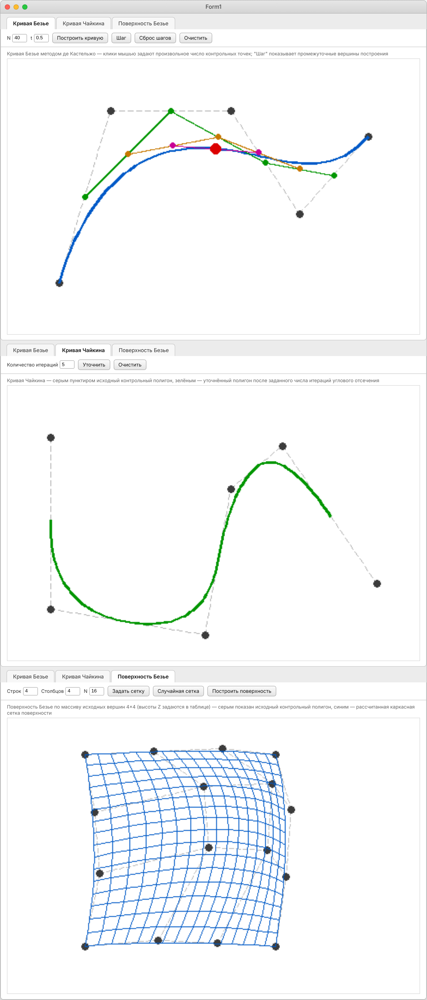

# Лабораторная работа №10. Алгоритмы построения кривых и поверхностей

**Дисциплина:** Компьютерная графика
**Среда разработки:** Lazarus IDE (Free Pascal Compiler)
**Вариант:** 1 (пункты задания 1, 3, 4; пункт 6 обязателен для всех вариантов)

## Постановка задачи

Создать приложение, реализующее построение кривых и поверхностей методами Безье и Чайкина:

1. Построение квадратичной кривой Безье: произвольное количество контрольных точек, поэтапное выполнение с расчётом промежуточных вершин, выбор параметра разбиения.
3. Построение кривой Чайкина.
4. Построение поверхности Безье: произвольное количество исходных вершин (массив), выбор параметра разбиения.
6. (обязательно для всех вариантов) отображение точек исходного контрольного полигона, вершин уточнённого контрольного полигона и выбор количества разбиений.

## Инструменты

- Free Pascal Compiler (FPC)
- Lazarus IDE
- Компоненты LCL: `TPageControl`, `TPaintBox`, `TStringGrid`, `Canvas`

## Решение

Форма содержит три вкладки (`TPageControl`):

| Вкладка | Назначение |
|---|---|
| «Кривая Безье» | построение кривой Безье методом де Кастельжо по произвольному числу контрольных точек |
| «Кривая Чайкина» | построение кривой методом углового отсечения Чайкина |
| «Поверхность Безье» | построение поверхности Безье по массиву исходных вершин |

Код приложения находится в файле [`Unit1.pas`](Unit1.pas).

Логика работы:

**Вкладка «Кривая Безье»:**
- клик мышью по полю добавляет очередную контрольную точку (их количество произвольно, не ограничено тремя);
- кнопка **«Построить кривую»** вычисляет N точек кривой (N – параметр разбиения) методом де Кастельжо и соединяет их сплошной линией;
- кнопка **«Шаг»** пошагово показывает само построение: на каждом нажатии отображается следующий уровень линейной интерполяции по текущему многоугольнику (ровно так, как это показано на рис. 1-9 методического пособия), пока не будет получена итоговая точка на кривой при заданном t;
- кнопка **«Сброс шагов»** убирает промежуточные построения, не стирая контрольные точки;
- кнопка **«Очистить»** стирает всё.

**Вкладка «Кривая Чайкина»:**
- клик мышью задаёт точки исходного контрольного полигона (пункт 6а);
- поле **«Количество итераций»** задаёт число разбиений (пункт 6в);
- кнопка **«Уточнить»** применяет процедуру Чайкина (Q_i = 3/4 P_i + 1/4 P_i+1, R_i = 1/4 P_i + 3/4 P_i+1 для каждого звена) заданное число раз и показывает получившийся уточнённый полигон (пункт 6б) – при достаточном числе итераций он визуально сходится к гладкой кривой;
- кнопка **«Очистить»** стирает всё.

**Вкладка «Поверхность Безье»:**
- поля **«Строк»**/**«Столбцов»** задают размер массива исходных вершин (произвольное количество, пункт 4а); кнопка **«Задать сетку»** подготавливает таблицу `TStringGrid` для ввода высот Z каждой вершины, кнопка **«Случайная сетка»** заполняет её случайными значениями для быстрой демонстрации;
- поле **N** задаёт параметр разбиения – число шагов по каждому из параметров u, v (пункт 4б);
- кнопка **«Построить поверхность»** вычисляет точки поверхности по формуле `p(u,v) = ΣΣ P[i,j]·B_i,n(u)·B_j,m(v)` (полиномы Бернштейна) и отображает каркасную сетку в косоугольной (кавальерной) проекции вместе с исходным контрольным полигоном.

## Демонстрация работы

**Кривая Безье (метод де Кастельжо), кривая Чайкина и поверхность Безье**

На первой вкладке серым пунктиром показан исходный контрольный полигон из пяти точек, синим – построенная кривая, цветными линиями – промежуточные вершины пошагового построения де Кастельжо при t=0.5, красной точкой – итоговая точка на кривой. На второй вкладке серым пунктиром – исходный полигон из шести точек, зелёным – результат пяти итераций отсечения углов Чайкина: ломаная заметно сгладилась и превратилась в плавную кривую. На третьей вкладке серым – исходная сетка контрольных вершин 4×4 с разными высотами Z, синим – рассчитанная каркасная сетка поверхности Безье, построенная по этим вершинам.

## Как запустить

1. Создать новый проект Application в Lazarus.
2. Разместить на форме `TPageControl` с тремя вкладками и компоненты по таблице выше с точными именами (см. `Unit1.pas` – секция `TForm1 = class(TForm)`).
3. Вставить код `Unit1.pas` целиком, привязать обработчики `OnClick`/`OnPaint`/`OnMouseDown`.
4. На macOS при ошибке линковщика `ld: malformed method list atom` добавить `-WM10.9` в Project Options → Compiler Options → Custom Options.
5. Запустить и опробовать каждую вкладку: кликами задать точки, нажать соответствующие кнопки построения.

## Вывод

Метод де Кастельжо наглядно демонстрирует геометрическую природу кривой Безье: любая точка на кривой получается последовательным линейным интерполированием сторон контрольного многоугольника, и при этом способ одинаково хорошо работает для произвольного числа контрольных точек (то есть для кривой любой степени), не требуя явного вычисления полиномов Бернштейна. Алгоритм Чайкина, напротив, относится к геометрическим (а не аналитическим) методам: он не даёт формулы кривой, а итеративно «срезает углы» многоугольника, и при увеличении числа итераций результат быстро сходится к гладкой кривой, полностью лежащей внутри выпуклой оболочки исходных точек. Поверхность Безье является естественным расширением кривой на двумерную область параметров (u,v): каждая точка поверхности – это взвешенная сумма всех узлов исходной сетки с весами-произведениями полиномов Бернштейна по обоим направлениям, поэтому форма поверхности полностью определяется расположением (в том числе по высоте) исходных контрольных вершин.
